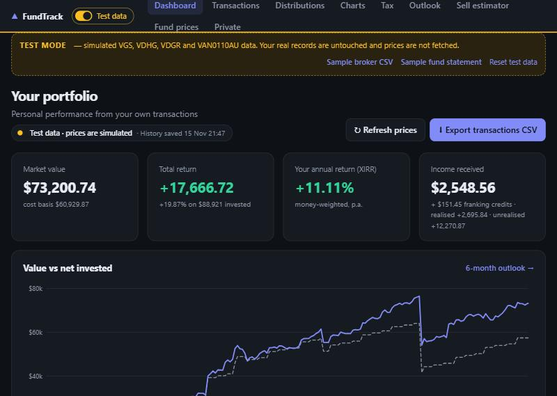
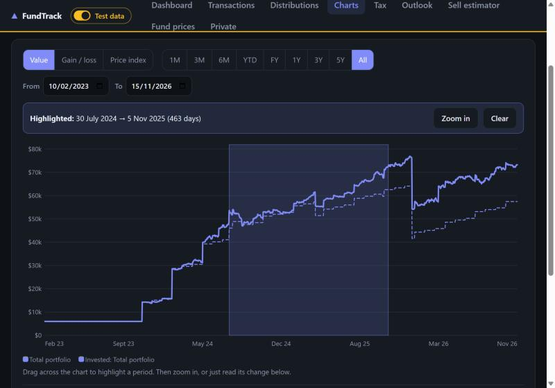
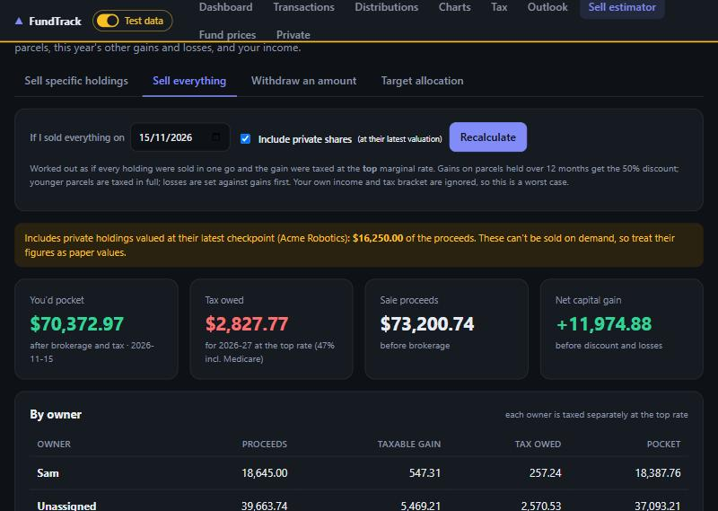
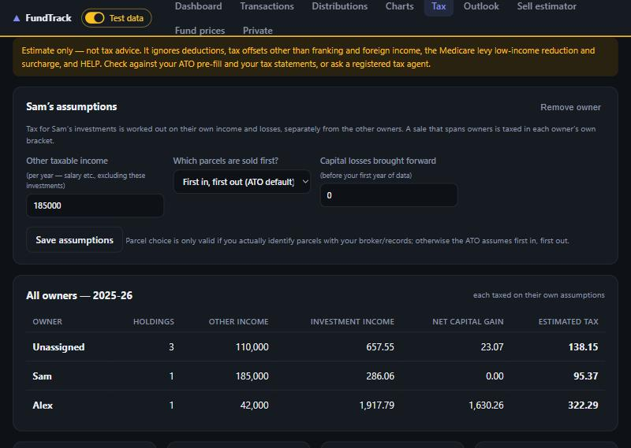
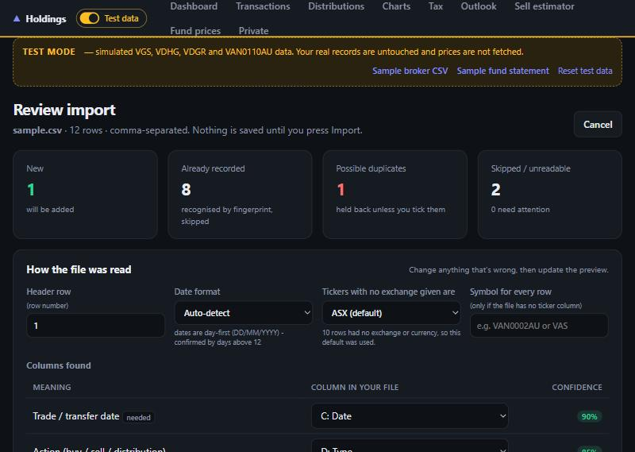

# Holdings

A personal investment tracker for Australian investors. It measures **your own** performance from the transactions you record, estimates Australian tax and capital gains, and tells you what a sale would cost before you make it.

It is written in Go using only the standard library, runs on your own computer as a small web app, and keeps all of your data in one local file. There is no account, no cloud and no telemetry.



## Features

- **Performance:** market value, cost basis, total return, income and XIRR (your money-weighted annual return) for ASX ETFs and shares, US stocks, Vanguard unlisted funds and private-company shares.
- **Live prices** while markets are open, saved history, Vanguard unit prices, and AUD conversion with the original currency shown in brackets.
- **Import** any broker or fund-manager CSV or xlsx: columns, dates and actions are detected automatically, and duplicates are recognised by fingerprint so overlapping files are safe. RSU releases and transfers in keep their cost basis.
- **Tax:** distributions, franking credits, parcel-based CGT with the 12-month discount, loss ordering, income-year estimates, and CSV exports. Separate assumptions per **owner**.
- **Sell estimator:** the tax on a sale before you make it, selling everything at the top bracket, withdrawing a dollar amount while keeping your target mix, and the same sale before and after the 1 July 2027 CGT change.
- **Private companies:** value checkpoints, valuation search, tax-deferred employee shares.
- **Charts, outlook and reconcile:** an interactive chart explorer, a six-month projection with ranges, and a check against your provider's holdings export.
- **Test mode:** a full set of simulated data you can switch on to explore everything.

<table>
<tr>
<td></td>
<td></td>
</tr>
<tr>
<td></td>
<td></td>
</tr>
</table>

## Quick start

You need [Go](https://go.dev/dl/) 1.22 or newer.

```bash
go run .
```

Then open <http://127.0.0.1:8080>. Flip the **Test data** switch in the header to explore with simulated data before entering your own.

| Setting | Default | Meaning |
|---|---|---|
| `ADDR` | `127.0.0.1:8080` | Listen address. The app has no login, so keep it on the local machine. |
| `DATA_FILE` | `data/fundtrack.json` | Where your data is stored (excluded from git). |
| `TEST_MODE` | unset | `1` starts in test mode, `0` forces real data. |

```bash
go test ./...      # run the tests (synthetic data, no network)
```

## Documentation

**Full documentation is in the wiki: start at [docs/wiki/Home.md](docs/wiki/Home.md).** It covers every page and feature, how the calculations work, what is and isn't supported, configuration, privacy and the code layout.

- [Getting Started](docs/wiki/Getting-Started.md)
- [Transactions](docs/wiki/Transactions.md) and [Importing Transactions](docs/wiki/Importing-Transactions.md)
- [Tax and CGT](docs/wiki/Tax-and-CGT.md), [Owners](docs/wiki/Owners.md) and the [Sell Estimator](docs/wiki/Sell-Estimator.md)
- [Private Companies](docs/wiki/Private-Companies.md), [Charts](docs/wiki/Charts.md) and [Reconcile](docs/wiki/Reconcile.md)
- [Configuration and Data](docs/wiki/Configuration-and-Data.md) and [Architecture](docs/wiki/Architecture.md)
- [Limitations and FAQ](docs/wiki/Limitations-and-FAQ.md)

The same pages are published as the repository's [GitHub wiki](../../wiki). They are plain Markdown kept in `docs/wiki` so they are versioned with the code; `./scripts/publish-wiki.ps1 -Repo owner/holdings` copies them to the wiki.
## Privacy

Your data stays on your machine. The app only contacts free public price and exchange-rate services (Yahoo Finance, the ASX, Vanguard Australia, Frankfurter/ECB), plus a web search if you ask for a private-company valuation. It never sends transaction amounts or personal details. The `data/` folder is git-ignored: don't commit it, and use invented figures in any tests or examples you add.

## Licence

Holdings is free software, licensed under the **GNU General Public License v3.0**. See [LICENSE](LICENSE). You may use, study, change and share it, and anything you distribute that is based on it must also be released under the GPL-3.0 with its source.

## Disclaimer

Holdings produces **estimates for your own records. It is not tax, legal or financial advice.** Tax rules are simplified and some situations are not modelled (companies, trusts, SMSFs, joint holdings, non-residents, deductions). Check anything that matters with the ATO or a registered tax agent.
