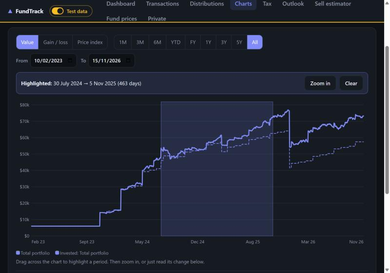
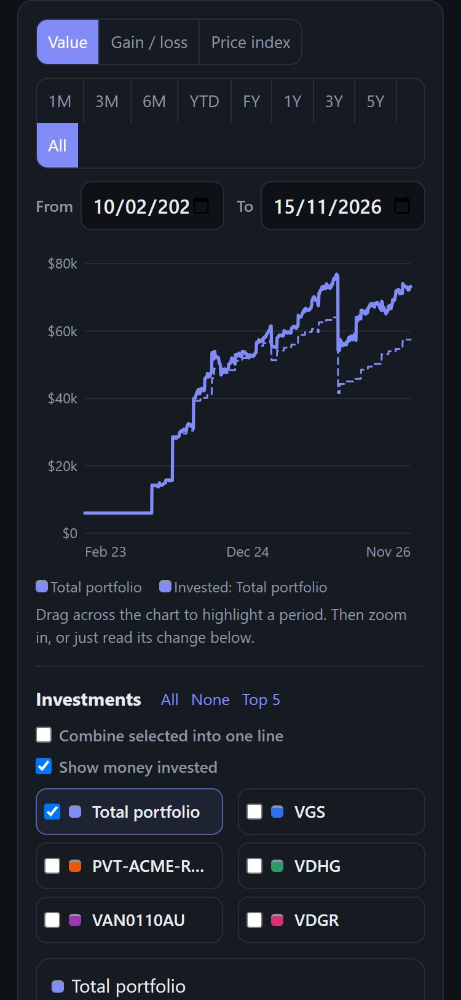

# Charts

The **Charts** page is an interactive explorer. Chart your total value, or pick and choose investments to compare; choose a date range; and drag across the chart to highlight a period and see exactly what happened in it.

## Choosing what to chart

- **Metric**:
  - **Value**: market value in AUD.
  - **Gain / loss**: value minus the money you put in (net of sales). It excludes distributions paid out as cash.
  - **Price index**: each investment's unit price rebased to 100 on the first day of the range. This is the fair way to compare investments of different sizes.
- **Investments**: tick *Total portfolio* and/or any investments. *All*, *None* and *Top 5* are shortcuts. Investments are listed by current value.
- **Combine selected into one line** adds the chosen investments together.
- **Show money invested** adds a dashed line in the same colour for each selected line (Value view only), so you can see the gap between what you put in and what it's worth.

## Date range

Quick ranges: **1M, 3M, 6M, YTD, FY** (the Australian financial year from 1 July), **1Y, 3Y, 5Y, All**. Or type exact **From** and **To** dates. The axis and scale re-fit to the range.

## Highlighting and zooming

Drag across the chart to shade a period. A bar shows the dates and length, and the table below switches to that period: for each line the **start**, **end**, **change** in dollars and percent, and the **invested** amount at the end. **Zoom in** makes the highlight the visible range; **Clear** removes it (so does clicking or double-clicking the chart). Hover for a crosshair and every line's value on that date.

> The value view includes money you added or took out, so a jump from a big purchase looks like growth. Use **Gain / loss** or **Price index** to judge performance.

## On a phone

The controls wrap, the investment list becomes two columns, and the stats table turns into stacked cards. Highlighting works by dragging with a finger.

## Remembered choices

Your selection, metric and range are remembered in the browser (they don't carry across devices).

## Data

One aligned data set is built on the server (a value, net invested amount and AUD unit price per holding for every day, weekly for histories over about seven years) and the browser does the picking, ranges and highlighting. Private companies appear as step lines, because they only change at checkpoints.
