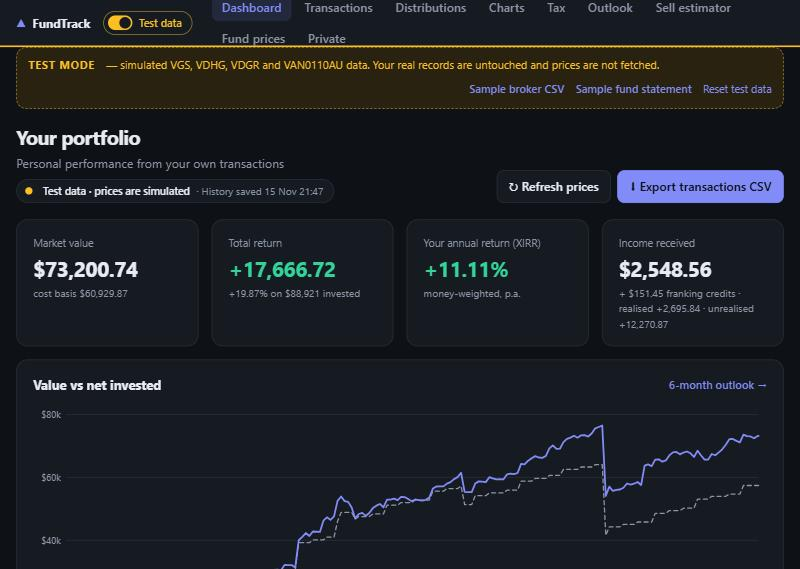
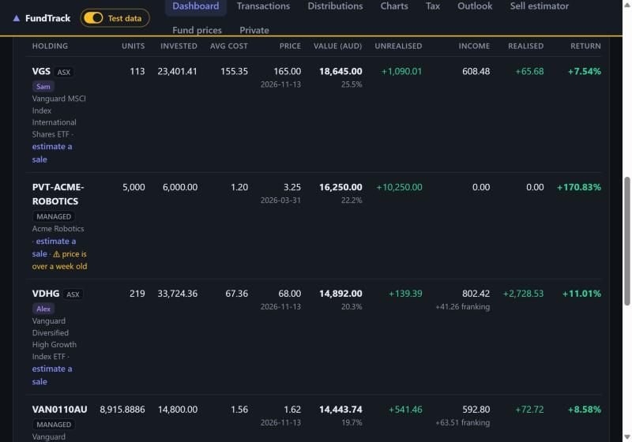

# Dashboard

The dashboard answers one question: *how am I actually doing?* Every figure comes from your own transactions, so it reflects when **you** invested, not the fund's published returns.

## The numbers at the top

| Tile | Meaning |
|---|---|
| **Market value** | What your open holdings are worth now, in AUD. The cost basis is shown underneath. |
| **Total return** | Unrealised gain + realised gains + income (+ franking credits, unless you excluded them), with the percentage on money invested. |
| **Your annual return (XIRR)** | A money-weighted annual rate of return calculated from your actual cash flows, so a big purchase just before a fall hurts more than one made long before. |
| **Income received** | Distributions and dividends, with franking credits, realised and unrealised gains. |

How these are calculated is covered in [Performance Calculations](Performance-Calculations).

## Value vs net invested

The chart plots your portfolio value against the money you put in (net of sales). The gap is your gain. Hover or touch for values. For more control (pick investments, date ranges, highlight a period) use the [Charts](Charts) page.

## Holdings

One row per open position:

- **Units**, **Invested** (all buys including brokerage), **Avg cost** (average cost per unit in AUD).
- **Price** in AUD. For foreign holdings the original currency is shown in small brackets, for example `$250.00 (USD 160.00)`. Prices from a live quote show a green dot and the quote time.
- **Value** and its share of the portfolio.
- **Unrealised**, **Income**, **Realised**, **Return** and **XIRR** for that holding.
- A tag for the market (ASX, US, MANAGED) and, if you use [Owners](Owners), the owner.
- **estimate a sale** opens the [Sell Estimator](Sell-Estimator) with that holding filled in.

Closed positions (everything sold) are listed below with their realised result.

## Status chip and refreshing

The chip under the title tells you where prices come from:

- *Live · ASX open · updated 10:42:05*: market hours, quotes polled about every 30 seconds.
- *Markets closed · prices as at Fri 13 Nov*: nothing is fetched while markets are closed.
- A warning appears if the last refresh failed (rate limit, bad symbol, Vanguard unreachable). The time under "History saved" only moves when something really updated.

**Refresh prices** forces a full refresh, including exchange rates. Details: [Prices and Exchange Rates](Prices-and-Exchange-Rates).

## Needs attention

A list of things worth checking, for example:

- A holding with no market price (it is valued at your last trade price).
- A price over a week old, or an exchange rate over a week old.
- A holding whose first record is a reinvestment, which usually means earlier purchases are missing. Use [Reconcile](Reconcile) to confirm.
- A private company whose latest valuation checkpoint is over a year old.
- A sale of more units than you held.

## Export

**Export transactions CSV** writes every transaction with AUD values, cost basis and realised gains. The app's own export re-imports as 100% "already recorded". **Export holdings CSV** (link above the holdings table) writes the current positions. Tax exports are on the [Tax](Tax-and-CGT) page.
