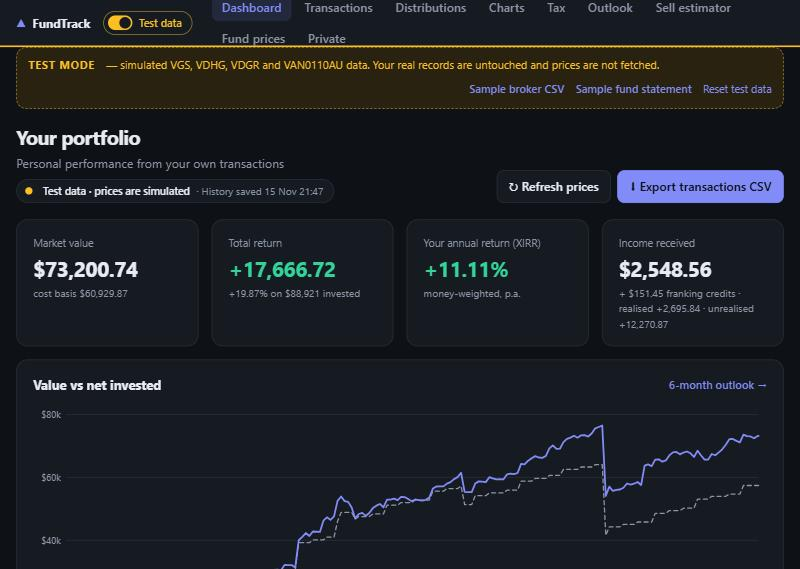
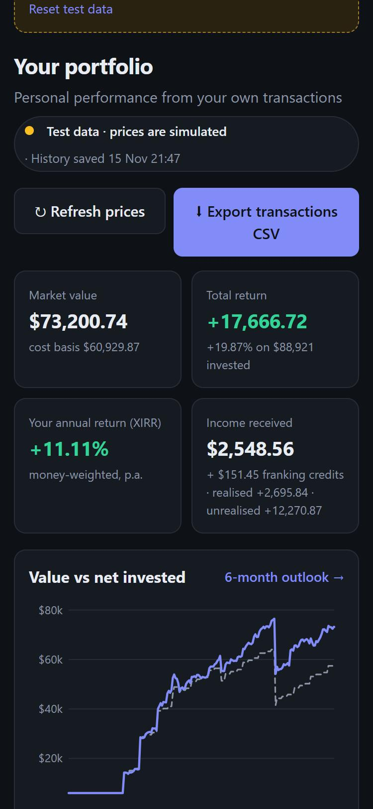

# Holdings wiki

Holdings is a personal investment tracker for Australian investors, written in Go with no third-party dependencies. It tracks ASX ETFs and shares, US stocks, Vanguard unlisted funds and private-company shares, measures **your own** performance from the transactions you recorded (not the fund's headline numbers), and estimates Australian tax, capital gains and the cost of selling.

It runs on your own computer as a small web app. Your data stays in a single file on your machine.

## What it does

| Area | What you get | Page |
|---|---|---|
| Performance | Market value, cost basis, total return, XIRR (your money-weighted annual return), income and franking | [Dashboard](Dashboard.md) |
| Recording | Buys, sells, distributions, reinvestments, RSU awards, transfers in, edits | [Transactions](Transactions.md) |
| Importing | Any broker or fund-manager CSV or xlsx, with automatic column detection and duplicate detection | [Importing Transactions](Importing-Transactions.md) |
| Prices | Live ASX/US prices while markets are open, Vanguard unit prices, manual prices, AUD exchange rates | [Prices and Exchange Rates](Prices-and-Exchange-Rates.md) |
| Tax | Distributions, franking credits, parcel-based CGT, the 12-month discount, income-year estimates | [Tax and CGT](Tax-and-CGT.md) |
| Owners | Separate tax assumptions for different people or entities | [Owners](Owners.md) |
| Selling | What a sale would cost in tax, selling everything, withdrawing a dollar amount, before/after the 1 July 2027 CGT change | [Sell Estimator](Sell-Estimator.md) |
| Planning | Target allocation, six-month outlook, interactive charts | [Target Allocation](Target-Allocation.md), [Outlook](Outlook.md), [Charts](Charts.md) |
| Unlisted holdings | Private companies with value checkpoints and valuation search, tax-deferred employee shares | [Private Companies](Private-Companies.md) |
| Checking | Compare against your provider's holdings export | [Reconcile](Reconcile.md) |
| Phone access | A Telegram bot that pulls prices, sends a snapshot and draws last week's graphs | [Telegram Bot](Telegram-Bot.md) |
| Trying it out | A full set of simulated data you can switch on and off | [Test Mode](Test-Mode.md) |

## Start here

1. [Getting Started](Getting-Started.md): run the app and try it with test data. Or [run it with Docker](Running-with-Docker.md).
2. [Transactions](Transactions.md) or [Importing Transactions](Importing-Transactions.md): get your own data in.
3. [Configuration and Data](Configuration-and-Data.md): where your data lives, backups and privacy.
4. [Limitations and FAQ](Limitations-and-FAQ.md): what is and isn't modelled.

For how the code is organised, see [Architecture](Architecture.md).

## Licence

Holdings is free software under the GNU General Public License v3.0.

## Important

Holdings produces **estimates for your own records. It is not tax, legal or financial advice.** Tax rules are simplified, and some situations (companies, trusts, SMSFs, joint holdings, non-residents, deductions) are not modelled. Check anything that matters with the ATO's own tools or a registered tax agent.

The layout adapts to phones as well as desktops. Tables collapse into labelled cards and charts redraw at the real screen width.
