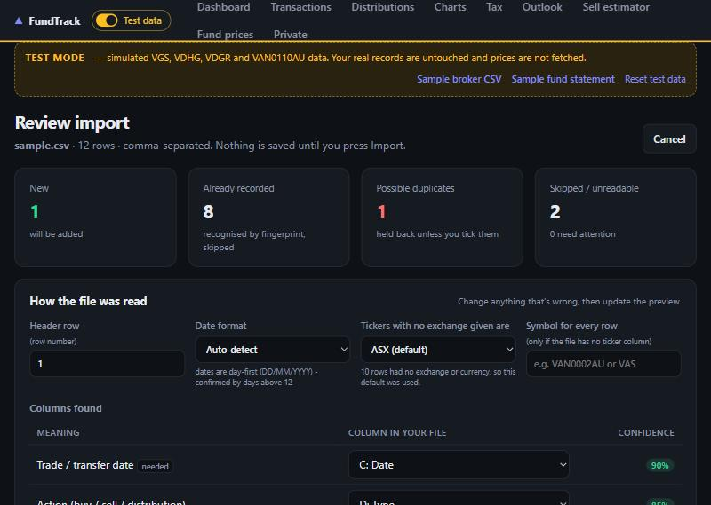

# Importing Transactions

Upload any broker or fund-manager export, or paste CSV text, on the **Transactions** page. There is no template to follow: the importer works out the layout itself, then shows you what it understood on a **review page** before anything is saved.

Accepted files: `.csv`, `.txt` and `.xlsx` (up to 8 MB).

## How the file is read

1. **Delimiter and header row.** Commas, semicolons, tabs and pipes are detected. Statement preambles, blank lines and total/footer rows are skipped.
2. **Columns.** Each column is scored from its header (many spelling variants) **and** from its contents (do the values look like dates, tickers, numbers, buy/sell wording?). The best match for each field is chosen.
3. **Dates.** Day-first, month-first, ISO and text forms such as `2 Jan 2025` and `20250102;093015`. The format is detected, and if every value is ambiguous (all days and months 12 or below) day-first is assumed and you are told.
4. **Numbers.** `$1,234.50`, `(12.5)`, `1.234,50`, `12.5CR` and signed quantities.
5. **Actions.** Buy, Bought, B, Application, Sell, Sold, Redemption, Distribution, Dividend, DRP/Reinvestment, plus RSU wording (below). Fees, deposits, interest, splits and other non-investment rows are skipped, with the reason shown.
6. **Tickers.** `VAS`, `VAS.AX`, `ASX:VAS`, `VAS AU Equity`, `NASDAQ:AAPL`, `AAPL.US`, APIR codes (`VAN0002AU`), ISINs and `Name (VAS)`. A ticker with no exchange gets the default market you choose.
7. **Money details.** Brokerage and GST (combined or separate), currency, FX rate and direction, franked and unfranked amounts, franking credits, withholding tax, capital gain components and tax-deferred amounts.

If the file has no ticker column you can enter one symbol for the whole file.

## The review page

Nothing is saved until you press **Import**. The page shows:

- Counts: new, already recorded, possible duplicates, skipped/unreadable.
- How the file was read: header row, date format, default market, and the column chosen for every meaning, each with a confidence score. Change anything that is wrong and press **Update preview**.
- Every row with its interpretation, warnings and reasons for skipping.

## Duplicate detection

Every transaction gets a **fingerprint**: a hash of its interpreted content (date, symbol, type, units, price, or amount for distributions). Brokerage, FX and notes are left out because institutions disagree on them. Any institution reference (contract note number) is kept too. On upload each row is classified:

| Class | Meaning | What happens |
|---|---|---|
| **Already recorded** | Same reference, or same fingerprint. | Skipped. Matching is count-aware: two identical trades on one day are two transactions, so only as many copies as you already have are skipped. |
| **Possible duplicate** | Same trade with a slightly different date (trade vs settlement date) or a rounded price. | Held back unless you tick *import anyway*. |
| **New** | Nothing similar recorded. | Imported. |

This means you can upload overlapping files over time. The same trade arriving from two brokers' formats is recognised, re-uploading an identical file is flagged, and the app's own export re-imports as 100% already recorded.

Each import is logged and can be **undone** from *Recent imports*.

## RSUs and awarded shares

Rows with wording such as *Release*, *Vest*, *Vested*, *Stock award*, *Award* or *RSU* import as **shares awarded**, not purchases. The units are added at the price in the file (the market value on the vest date), which becomes the cost base and the date the 12-month CGT discount clock starts. *Sell to cover* rows import as normal sales.

## Transfers in (shares moved from another broker)

*Transfer In*, *In specie* and similar rows (and a bare *Transfer* that moves units of a named holding) import as acquisitions that **keep their original cost basis**, never the market value on the day of the move.

- Map a **cost basis** column. Headers like "Cost basis", "Cost base", "Original cost" are read as the total; "Cost basis per share" is read per unit.
- If the file has an **original acquisition / vest date** column ("Date acquired", "Vest date"), the transaction is dated that day so the discount follows it, and the transfer date goes into the notes.
- Without an acquisition date the transfer date is used and the review screen warns you.
- A transfer row with **no cost basis is rejected** instead of being priced at market value. Add the cost on the [Transactions](Transactions) page, or add a cost basis column to the file.
- Transfers out are ignored.

## Examples of layouts that work

- CommSec, SelfWealth, Stake, IBKR flex queries, Vanguard Personal Investor statements, and similar broker exports.
- A fund manager statement with only *Date, Description, Units, Unit price, Amount* (enter the fund's APIR code as the symbol for the whole file).
- The app's own transactions export.

The importer is heuristic. When a file is unusual, use the review page to correct the mapping; the "How the file was read" panel is there for that.

## Sample files

In [Test Mode](Test-Mode) the banner offers a sample broker CSV and a sample fund statement built from the test data, so you can try the duplicate handling without any real data.
