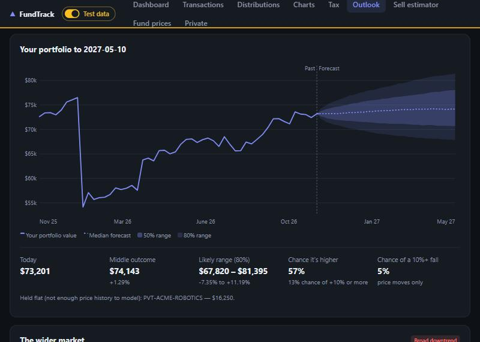

# Outlook (six-month projection)

The **Outlook** page shows where your portfolio, and each holding, could plausibly be in about six months. It is a **statistical projection, not a prediction**: it shows *ranges* with probabilities, built from each holding's own past behaviour and today's market conditions.

## What you see

- **Portfolio chart**: past value, a median forecast, and 50% and 80% ranges.
- **Summary**: today's value, the middle outcome, the likely (80%) range, the chance the value is higher, and the chance of a 10% or larger fall.
- **The wider market**: S&P/ASX 200, S&P 500, VIX and AUD/USD with trend (50- and 200-day averages), returns, volatility and drawdown.
- **Each holding**: a chart with its range, its beta and correlation against the relevant index, and a one-year regression trend line.

Hover or touch for values.

## How it works

1. **Past behaviour.** Up to five years of daily history is used. Each holding's own daily moves are **bootstrapped** (the same days across holdings, so correlation is preserved) around an assumed drift, producing thousands of possible paths.
2. **Assumption** (selector at the top of the page):
   - **Balanced**: the average of last year's trend, the full-history trend and a 6% long-run assumption, capped, plus a ±1.5% a year tilt when the market is clearly above or below its 200-day average.
   - **Recent trend continues**: the last 12 months' growth rate carries on (capped).
   - **Long-run average**: about 6% a year regardless of recent performance.
   - **No growth**: zero expected drift, so only volatility moves the range.
3. **Volatility** is scaled by how choppy the last 60 days were compared with the long run.

## Limits

- Price only: distributions are not included.
- A holding needs enough price history to be modelled. Unlisted funds need roughly 120 prices. Holdings that can't be modelled (including private companies) are held flat at their current value and listed in a note.
- Markets are uncertain and past performance doesn't guarantee future results. The real result can land outside the bands. This is not financial advice.
