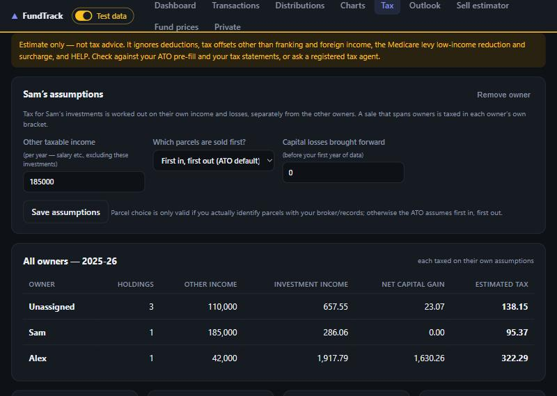

# Owners

If investments are held by different people or entities who are taxed separately, tag each investment to an **owner** so the tax is worked out on the right person's income. Owners are optional: with none set up, everything is taxed as one person.

## Setting up

On the **Tax** page, scroll to the **Owners** card:

1. **Add owner**: give them a name (up to 40 characters, unique). Names are matched without regard to case, and "Unassigned" is reserved.
2. **Who holds what**: choose an owner for each investment and press **Save ownership**.
3. A tab appears at the top of the Tax page for each owner plus **Unassigned** (the default owner). Each tab has its own **assumptions panel**: other taxable income, losses brought forward and parcel method.
4. **Remove owner** (in their panel) deletes the owner and returns their investments to unassigned.

An **all-owners summary** table on the Tax page shows each owner's holdings count, other income, investment income, net capital gain and estimated tax for the selected income year.

## How tax is worked out

Tax is always computed **per owner**:

- Each owner sees only their own investments' transactions, with their own other income, losses brought forward and parcel method.
- Distributions, parcels, capital gains, franking and offsets are all kept apart, so one owner's loss never offsets another owner's gain.
- Untagged investments belong to the default owner, whose assumptions are the original ones. An investment tagged to a deleted owner also falls back to the default owner.
- The CSV exports follow the selected owner.

## Selling across owners

The [Sell Estimator](Sell-Estimator.md) splits a sale by owner:

- Each owner's part is taxed on **their own** assumptions, then the results are added.
- A **Tax by owner** table shows each owner's net proceeds, capital gain added, tax, cash after tax and the income assumed.
- The 1 July 2027 comparison is shown per owner.
- Choosing the **top bracket** applies it to every owner.
- A sale that touches only one owner uses just that owner's assumptions.

For example, a $1,000 long-term gain (taxable $500 after the discount) is taxed at 47% for an owner on $200,000, which is $235, but only the 2% Medicare levy ($10) for an owner with no other income. Selling both together gives $245, not the $470 you'd get by taxing both at the top rate.

The dashboard and the estimator holding lists show each holding's owner as a tag.

## Limitations

- An investment has **one** owner. If two people hold the same ticker, record it as two entries (for example with different symbols or one under an alias).
- Joint holdings are not split automatically.
- Companies, trusts and SMSFs have different tax rules that aren't modelled: owners are taxed as resident individuals.
