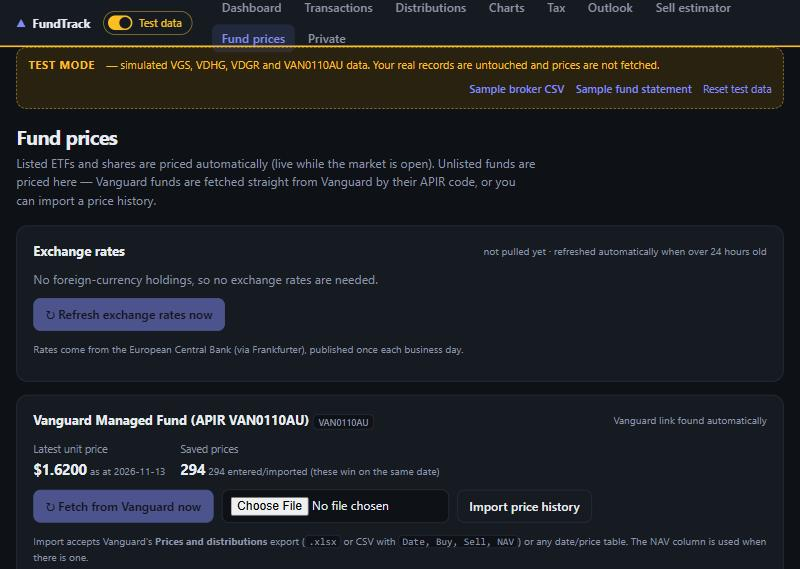

# Prices and Exchange Rates

All data sources are free and need no account or API key.

| Data | Source |
|---|---|
| ASX and US prices, split-adjusted daily closes, ex-dividend dates | Yahoo Finance chart API (unofficial). ASX symbols use the `.AX` suffix. |
| ASX distribution pay date and franking % | The ASX's public research API. |
| Vanguard unlisted fund unit prices | Vanguard Australia's own site API, the data behind each fund's *Prices and distributions* tab. |
| AUD exchange rates | The European Central Bank via Frankfurter (`api.frankfurter.dev`). |
| Market context (S&P/ASX 200, S&P 500, VIX, AUD/USD) for the [Outlook](Outlook) | Yahoo Finance. |

## Live prices

While a market is open, FundTrack polls a small quote for every listed holding about every **30 seconds**:

- ASX: 10:00 to 16:10 Sydney time. US: 09:30 to 16:00 New York time.
- Weekends and public holidays are detected from the trading session Yahoo returns with each quote.
- Nothing is fetched while a market is closed.
- If Yahoo rate-limits or fails, ASX symbols fall back to the ASX's own bid/ask midpoint, and only while trading. A rate limit makes the app back off instead of hammering Yahoo.

The dashboard shows the status ("Live · ASX open · updated 10:42:05" or "Markets closed · prices as at Fri 13 Nov") and refreshes its numbers by itself.

## Saved history

Daily prices (up to five years) are **saved in your data file** and only topped up (about the last ten days) on each refresh, so a restart never re-downloads everything. Live quotes live in a small side file next to the data file so the main file isn't rewritten every few seconds. Benchmarks are incremental too, and secondary lookups (ASX distribution details, Vanguard prices) are throttled to a few times a day.

The background refresh runs every 30 minutes. "History saved" on the dashboard only moves when something really updated. Any failure is stored and shown.

## Fund prices page

### Vanguard unlisted funds

Hold the fund under its **APIR code** (for example `VAN0108AU`, market *Unlisted fund*). FundTrack finds Vanguard's fund id from the APIR code automatically and fetches the daily NAV history. You can also set the fund id by hand (the number after `portId=` in the fund page's address).

- Prices are fetched on refresh (at most a few times a day) or with **Fetch from Vanguard now**.
- **Import price history** reads Vanguard's export (`.xlsx` or CSV with `Date, Buy, Sell, NAV`, or any date/price table). NAV is preferred, then unit price, then sell, then buy. Imported prices override fetched ones on the same date.
- **Add or correct individual prices** takes one `date, price` per line.
- The transaction importer also accepts `.xlsx`.

### Other unlisted holdings

Unlisted funds without a Vanguard link, and private companies, are priced from the prices you enter. For private companies use value checkpoints: [Private Companies](Private-Companies).

## Exchange rates

Foreign holdings are converted to AUD. The rate used for each transaction is the ECB rate on the transaction date (or the previous business day), unless you override it. Holdings are valued at the **latest** rate.

- Each refresh also pulls the newest published rate, not just history.
- Rates are refreshed automatically when the last successful pull is **more than 24 hours old** (checked every 30 minutes), and on demand with **Refresh exchange rates now** at the top of the Fund prices page. A failed pull doesn't reset the 24-hour clock.
- Foreign unlisted funds and private companies get rates too.
- Everywhere an amount is converted you see **AUD first with the original amount in brackets**, for example `3,200.00 (USD 2,000.00)`. The rates and their dates are shown under the holdings table, and a warning appears if the latest rate is over a week old.

## Failure handling

Rate limits, unknown symbols and unreachable services are saved and shown on the dashboard instead of failing silently. If a price can't be found, the holding is valued at your last trade price and flagged.
