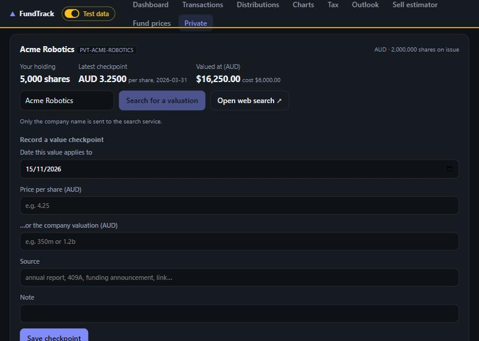
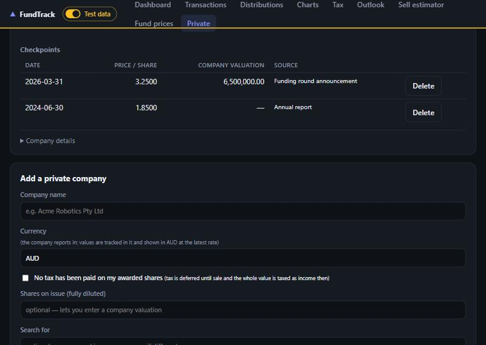

# Private Companies

Shares in a company that isn't listed have no market price. The **Private** page tracks them using **value checkpoints** that you record, and can search the web for reported valuations to help you find a newer figure.

## Adding a company and your shares

1. **Add a private company**: name, currency, optionally the **shares on issue** (fully diluted) and a different name to **search for**. The symbol is generated from the name.
2. Record your shares as ordinary **buy / sell / award** transactions on the [Transactions](Transactions) page with market *Private company*. A currency box on that form sets the currency for a new company.
3. Record **value checkpoints**.

## Value checkpoints

A checkpoint is a date plus either:

- a **price per share**, or
- the company's **reported valuation** (for example `350m` or `1.2b`), which is divided by the shares on issue to get a price per share. If you haven't set the shares on issue, the price is scaled from an earlier checkpoint that had both a price and a valuation (ignoring dilution). Otherwise you're asked for the shares on issue.

You can add a source and a note. A second checkpoint for the same date replaces the first. Checkpoints can be deleted.

The holding is valued at its **latest checkpoint**, carried forward until you record a newer one. Nothing is estimated in between. A holding whose latest checkpoint is over about 13 months old is flagged on the dashboard, because the total may be well out of date.

## Searching for a valuation

**Search for a valuation** looks through public web results for phrases like "valued at $X" and lists each figure with its date, currency and source link, newest first.

- Only the **company name** is sent to the search service.
- Figures are read from search snippets and can be wrong, out of date, in the wrong currency or about a different company. Open the source and check before recording.
- **Use as a checkpoint…** fills in the form for you to review. **Nothing is saved until you press Save.**
- A figure in another currency is converted to the company's currency at the exchange rate on the article's date, with the original amount shown.
- If the search service doesn't respond, an error and an **Open web search** link let you search yourself.
- The search is disabled in [Test Mode](Test-Mode).

## Currency

A private company can be tracked in any currency. Prices, checkpoints and cost stay in that currency, and values are shown in **AUD at the latest exchange rate** with the original amount in brackets. A purchase converts at the rate on its own date. You can change a company's currency in **Company details**. Because recorded prices are plain numbers, changing it re-labels them, so you must tick a box confirming they really are in the new currency.

## Tax-deferred employee shares

If the shares were awarded under an employee share scheme and **no tax has been paid yet**, tick *No tax has been paid on my awarded shares* in **Company details**. Selling then counts the whole sale value as ordinary income, taxed in full with no 50% discount and no capital gain or loss. Without this, awarded shares recorded at their value on the award date can produce a capital *loss* when the value falls, which would wrongly offset gains on your listed holdings. See [Tax and CGT](Tax-and-CGT).

## Selling and private shares

- The **withdrawal planner** never suggests private holdings, because they can't be sold on demand.
- **Sell everything** has an *Include private shares* tick box. See [Sell Estimator](Sell-Estimator).
- They can be priced in *Sell specific holdings*. Treat the figures as paper values.

## Deleting a company

**Company details → Delete this company.** A company with no transactions is removed straight away. One with transactions is removed together with them, its checkpoints and its saved prices only after you tick a confirmation box. This can't be undone, and other holdings are untouched.
