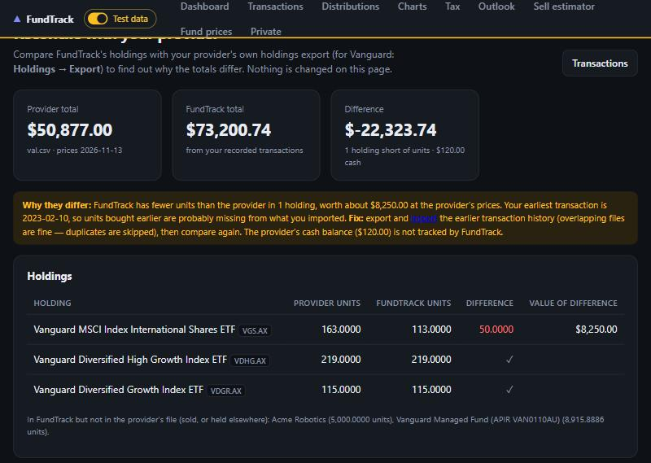

# Reconcile

If FundTrack's total doesn't match what your provider shows, the **Reconcile** page finds out why. Upload the provider's **holdings export** (for Vanguard: *Holdings → Export*; CSV or xlsx) and it compares units per holding.

**It changes nothing.** It is a diagnostic only.

## What it shows

- **Provider total**, **FundTrack total** and the **difference**, with the number of holdings short of units and any cash balance.
- A table per holding: provider units, FundTrack units, the difference in units and its value at the provider's price. A tick means they match.
- A note for holdings that FundTrack has but the provider's file doesn't list (sold, or held elsewhere), and for provider holdings that couldn't be matched.
- A banner explaining the likely cause.

## The usual cause

A transaction export only covers a window of time. Anything bought before it is missing, so FundTrack's units, value, cost and returns come out short. The fix is to **export and import the earlier history** (overlapping files are fine, because duplicates are skipped by fingerprint) and compare again. FundTrack deliberately doesn't invent opening balances, because the cost of pre-window units isn't known.

The dashboard also warns when a holding's first record is a reinvestment, which usually means earlier purchases are missing.

## How the file is read

- The header row is found automatically. Columns are matched by name: investment name, units/quantity, price, value, price date and an optional code.
- Account name and number columns are **ignored and never stored**.
- Cash rows (an investment name containing "cash" with no units or price) are summed as cash. A row saying "total" sets the provider total.
- Holdings are matched to yours by code, exact name, a name that contains the other, or a close word-overlap.

## Limitations

- Cash balances aren't tracked by FundTrack, so a cash balance shows as part of the difference.
- Differences in price date between the provider and FundTrack show up as value differences. A price-mismatch note appears when FundTrack's price differs from the provider's by more than 1%.
