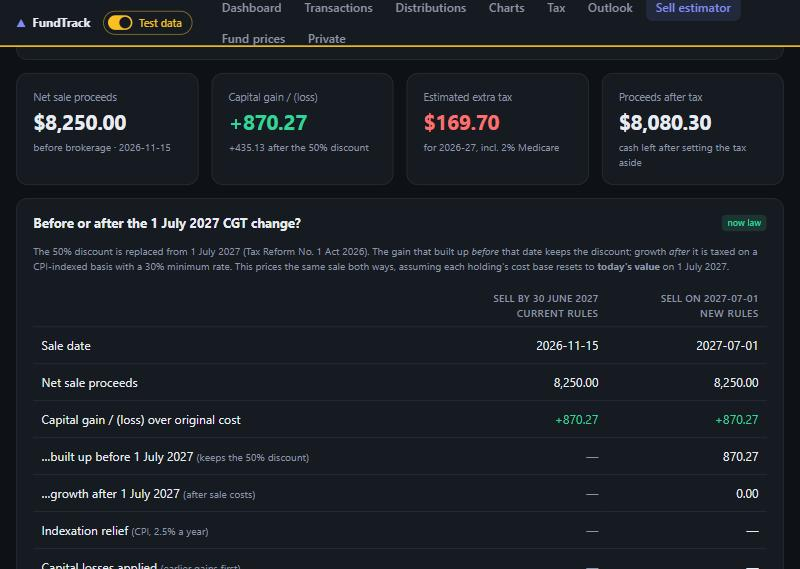
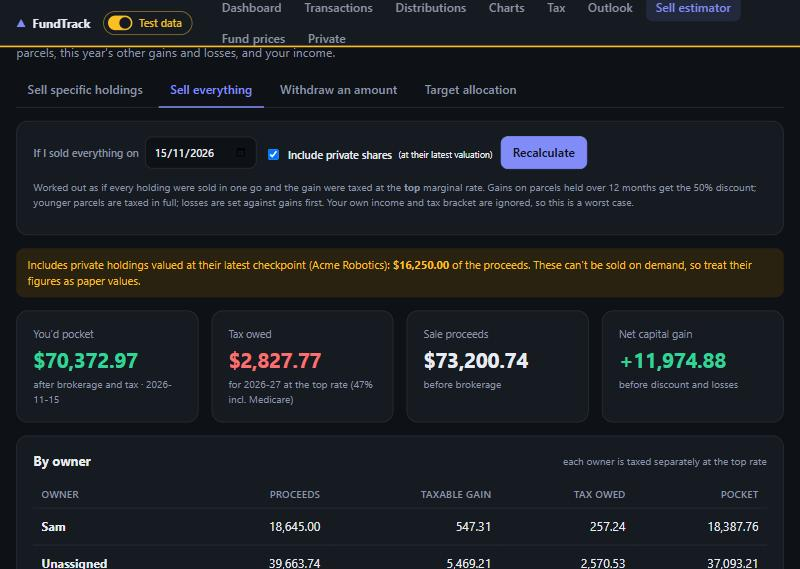
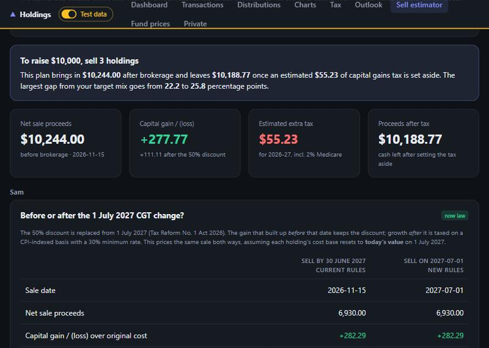

# Sell Estimator

The estimator answers *"what would selling these cost me in tax, and how much would I keep?"* **before** you sell. It adds hypothetical sales to your real parcels and recomputes the income year, so existing gains and losses, carried-forward losses, franking offsets and your other income are all accounted for.

It has four tabs: **Sell specific holdings**, **Sell everything**, **Withdraw an amount** and **Target allocation** ([Target Allocation](Target-Allocation.md)).

## Tax rate to assume

**Sell specific holdings** and **Withdraw an amount** offer a **Tax rate to assume** choice (**Sell everything** always uses the top bracket):

- **Top bracket** (47% including Medicare) whatever your income: the cautious case.
- **My income**: use the other income set on the [Tax](Tax-and-CGT.md) page (each owner's own income if you use [Owners](Owners.md)).

If no income is recorded anywhere, the top bracket is the default. Choosing *My income* while it is $0 shows a warning, because the sale is then taxed as your only income (the first $18,200 is tax-free) and the result looks far too low.

## Sell specific holdings

Add one or more holdings and say how much of each to sell: a number of units, `all`, or a dollar amount to raise. Optionally set a price (default: the latest price, converted at today's rate for foreign holdings), brokerage and a sale date. A future date uses today's prices.

You get:

- **Net sale proceeds**, **capital gain/(loss)** (and the gain after the 50% discount), **estimated extra tax** for the income year and **proceeds after tax**.
- The three parcel methods compared for the same sale (FIFO, highest cost first, lowest taxable gain), with the lowest-tax one flagged.
- A hint when **waiting past the 12-month mark** would cut the tax (assuming an unchanged price).
- A table of what you're selling, and **before/after for the income year**.
- The **new-rules comparison** (below).

The page URL carries the form values, so an estimate can be bookmarked or shared.

## Sell everything

Prices selling **every holding on one day**, with the gain taxed at the **top marginal rate** whatever your income is, which makes it a worst case. It shows:

- **You'd pocket**, **tax owed**, **sale proceeds** and the net capital gain.
- How the tax is worked out: long-term gains (over 12 months, 50% discount), short-term gains (taxed in full), capital losses, earlier losses used, the discount, taxable capital gain and tax.
- Any **employee share income** from tax-deferred awards, taxed in full ([Tax and CGT](Tax-and-CGT.md)).
- A **by holding** table and, if you use owners, a **by owner** table.
- An **Include private shares** tick box (on by default). Private shares are priced at their latest checkpoint value and flagged as paper values. Leave it off to price only the sellable holdings; the page still reports what the private shares are worth.

## Withdraw an amount

Tell the planner how much cash you want out and it chooses what to sell, in this order of priority:

1. **Diversification.** Using the targets from [Target Allocation](Target-Allocation.md), it sells what is *overweight* and protects what is underweight, finishing as close to your target mix as possible (an exact least-squares rebalance). With no targets set, your current mix is the target, so a sale is spread roughly in proportion.
2. **Performance judged against intent.** Each holding's return is compared with *its own* expected return, weighted by how much of its intended horizon has passed. It only nudges the target, by at most 10% of itself, so it can tip a close call but never override balance. Holdings with no purpose set are never judged on performance.
3. **Tax.** Within each holding it uses parcels held over 12 months first (50% discount), lowest taxable gain first. A parcel under 12 months old is used only if avoiding it would leave you more than 2.5 points further from target.

Options: brokerage per holding, sale date, **after tax** (the amount is the cash you want in hand after estimated CGT), and restricting which holdings to sell from. A **lowest tax overall** plan is shown for comparison, with how far it leaves you from your target. Listed securities sell in whole units, so the total can be slightly over. Each parcel shows why it was chosen.

Private holdings are never suggested by the planner, because they can't be sold on demand.

## Selling across owners

With [Owners](Owners.md), each estimator splits the sale by owner and taxes each owner's part on their own assumptions, with a **Tax by owner** table. See that page for an example.

## Before or after 1 July 2027

The Tax Reform No. 1 Act 2026 replaces the 50% discount from 1 July 2027. Every estimate shows the same sale under both sets of rules:

- **Current rules** (sell by 30 June 2027): 50% discount on parcels held over 12 months.
- **New rules** (sell on or after 1 July 2027): each holding is treated as re-acquired at its value just before 1 July 2027, assumed to be **today's price**. The gain built up to then is *deferred* and keeps the 50% discount; growth after it is taxed on a **CPI-indexed** basis (indexation can't create or enlarge a loss) with a **30% minimum tax** top-up on that growth. Capital losses are applied to the deferred gains first.

You can change the assumptions in a collapsible panel: the sale date under the new rules, price growth after 1 July 2027 (% a year, default 0) and CPI (default 2.5%). With no growth the two regimes cost the same; the gap appears as soon as prices rise.

Not modelled: the minimum-tax exemption for income-support recipients, trusts, valuation by the ATO's apportionment method, and how the 12-month test works after the reset (the original purchase date is assumed). The employee-share income from tax-deferred awards is ordinary income under both sets of rules.

## Private shares and the estimator

Private shares can be included in *Sell everything*, and *Sell specific holdings* can price any of them, using their latest checkpoint value. Treat these as paper figures. See [Private Companies](Private-Companies.md).
