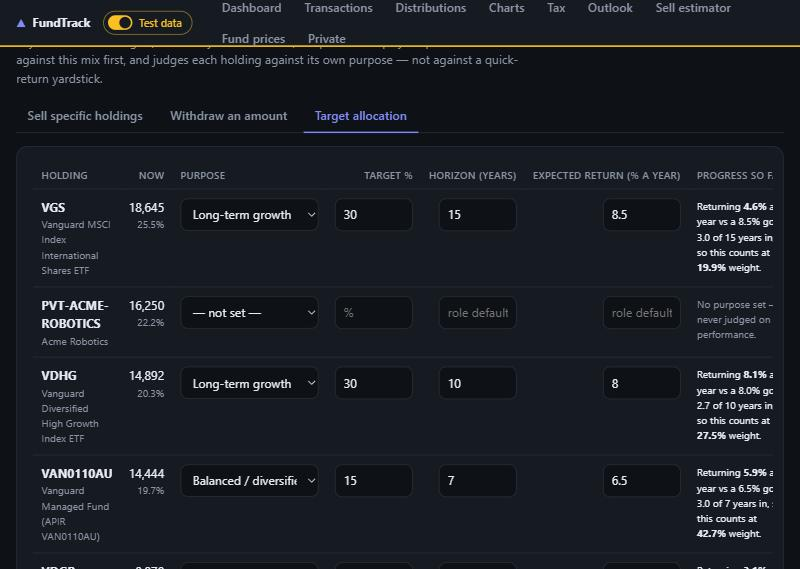

# Target Allocation

The **Target allocation** page (a tab of the [Sell Estimator](Sell-Estimator)) records what each holding is *for*. The withdrawal planner uses it to decide what to sell, and judges each holding's performance against its own purpose instead of against a quick-return yardstick.

## What you set

For each holding:

| Field | Meaning |
|---|---|
| **Purpose** | Long-term growth, Balanced / diversified, Defensive / income, Short-term / liquidity, or *not set*. Each purpose has default values: growth 8% over 10 years, balanced 6.5% over 7 years, defensive 4% over 3 years, short-term 3% over 1 year. |
| **Target %** | The share of the whole portfolio you intend this holding to be. Blank means no target. |
| **Horizon (years)** | How long you intend to hold it. Blank uses the purpose's default. |
| **Expected return (% a year)** | The return you expect from it. Blank uses the purpose's default. |

The table also shows the current value and weight, and a **progress** note for each holding, for example *"Returning 4.6% a year vs a 8.5% goal, 3.0 of 15 years in, so this counts at 19.9% weight."*

## How the planner uses it

1. **Balance first.** It sells what is overweight and protects what is underweight to finish as close to your target mix as it can. With no targets set, your current mix is treated as the target.
2. **Performance against intent.** Each holding's return is compared with *its own* expected return. That verdict is weighted by how much of its intended horizon has passed: a 10-year growth holding two years in counts at 20%, while a short-term holding past its horizon counts in full. The result only nudges the target, by at most 10% of itself, so a long-term holding in a quiet patch isn't punished. Holdings with no purpose set are never judged on performance.
3. **Tax.** Within each holding, the parcels with the lowest taxable gain are used first.

Details and options: [Sell Estimator](Sell-Estimator).

## Tips

- Targets should add up to roughly 100%, but they don't have to. They are used as relative weights.
- In [Test Mode](Test-Mode) a target mix (VGS 30%, VDHG 30%, VDGR 25%, VAN0110AU 15%) is seeded that deliberately differs from the current mix, so a withdrawal has something to rebalance.
