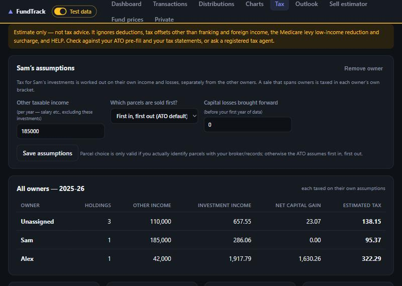

# Tax and CGT

The **Tax** page estimates the tax position on your investments for an Australian-resident individual, by income year (1 July to 30 June). It's an estimate for planning and record keeping, not tax advice.

## Your assumptions

| Setting | Meaning |
|---|---|
| **Other taxable income** | Your income per year from everything else (salary etc.), excluding these investments. Investment income is stacked on top of it to find the tax. |
| **Which parcels are sold first** | First in, first out (the ATO default), highest cost first, or lowest taxable gain (discount-aware). A non-FIFO choice is only valid if you actually identify the parcels with your broker/records. |
| **Capital losses brought forward** | Net capital losses from before your first year of data. |
| **Include franking credits in return figures** | Whether franking credits count in [Performance Calculations](Performance-Calculations). |

With [Owners](Owners) set up, every owner has their own panel for income, losses and parcel method.

## Estimate by income year

For the selected income year the page shows:

1. **Distributions**: cash received, franked amounts, franking credits (grossed-up and assessable), unfranked/interest/foreign income, distributed capital gains (discountable and other), tax-deferred amounts and the foreign income tax offset. A warning counts distributions with no breakdown (treated as unfranked income).
2. **Capital gains**: gains on assets held over 12 months, other gains, losses, losses brought forward, the discount applied, **net capital gain**, and losses carried forward. Every disposal is listed with its parcel, days held, cost base, proceeds and gain.
3. **Estimated tax**: marginal tax plus 2% Medicare levy on the investment income stacked on your other income, less franking credits (excess refunded) and the foreign income tax offset.

### Tax rates

Resident marginal rates by year, plus a flat 2% Medicare levy:

| Income year | Rates |
|---|---|
| 2022-23 to 2023-24 | 0% to $18,200, 19% to $45,000, 32.5% to $120,000, 37% to $180,000, 45% above |
| 2024-25 and 2025-26 | 0% to $18,200, 16% to $45,000, 30% to $135,000, 37% to $190,000, 45% above |
| 2026-27 | as above with the first rate cut to 15% |
| 2027-28 onwards | first rate 14% |

The top marginal rate including Medicare is **47%**.

## Franking and foreign tax

- **Franking credits** reduce your tax and any excess is refunded.
- The **foreign income tax offset** is capped at the Australian tax on that income once the offset exceeds $1,000.
- For an AUD fund, foreign tax is an offset on top of the distribution. For a foreign-currency holding, it is withheld from the dividend and already inside the gross amount.
- For ASX holdings the app pulls the latest distribution's pay date and franking % from the ASX to pre-fill credits.

## Capital gains (CGT)

CGT is **parcel-based**:

- Each buy, reinvestment, award or transfer-in is its own parcel with its own acquisition date. Cost base includes brokerage, and foreign trades are converted at the transaction-date rate.
- A sale consumes parcels using the method you chose (FIFO, highest cost, or lowest taxable gain).
- **12-month discount**: a parcel owned for more than 12 months qualifies for the 50% discount on its gain.
- **Loss ordering**: capital losses are applied to full-rate gains first, then to discount gains, and only then is the discount applied to what's left. Losses carry forward.
- **Tax-deferred distributions** reduce the cost base. If the cost base is exhausted the excess is a capital gain (CGT event **E4**).

## RSUs, transfers and unknown dates

- An **award** is acquired on the vest date with a cost base equal to its market value that day.
- A **transfer in** keeps its original cost basis and, if known, its original acquisition date.
- If you don't know the acquisition date but are sure the units were held over 12 months, the **held over 12 months** flag treats the parcel as acquired a year and a day before the date. See [Transactions](Transactions).

## Tax-deferred employee shares

For awarded shares in a private company on which **no tax has been paid yet** (an employee share scheme with tax deferred until sale), tick *No tax has been paid on my awarded shares* in the company's details on the [Private Companies](Private-Companies) page. Selling those shares then:

- counts the **whole sale value** as ordinary income, taxed in full at your marginal rate;
- gives **no 50% discount** and creates **no capital gain or loss**, so it no longer offsets gains on your listed holdings;
- shows as *employee share income* on the Tax page, in the estimators and in the new-rules comparison.

Whether tax is deferred, and when the taxing point is, depends on your scheme. Check your plan documents or an adviser.

## CGT before and after 1 July 2027

The Treasury Laws Amendment (Tax Reform No. 1) Act 2026 changes how CGT works from 1 July 2027. The [Sell Estimator](Sell-Estimator) prices the same sale under both sets of rules side by side. The Tax page itself applies the **current** rules to everything recorded, including any sales dated on or after 1 July 2027.

## Exports

Each export follows the selected income year and owner:

| File | Contents |
|---|---|
| `/export/tax-summary.csv` | One row per income year with the full tax summary. |
| `/export/tax-distributions.csv?fy=2025-26` | Every distribution with its tax components. |
| `/export/tax-cgt.csv?fy=2025-26` | Every CGT event: parcel, days held, cost base, proceeds, gain and discount flag. |

## Not modelled

The Medicare levy low-income reduction and surcharge, HELP/HECS, deductions and offsets other than franking and foreign income, companies, trusts, SMSFs and joint holdings (see [Owners](Owners) for a partial workaround), wash-sale and trading-stock rules, foreign-currency hedging, and non-resident or part-year residency. See [Limitations and FAQ](Limitations-and-FAQ).
