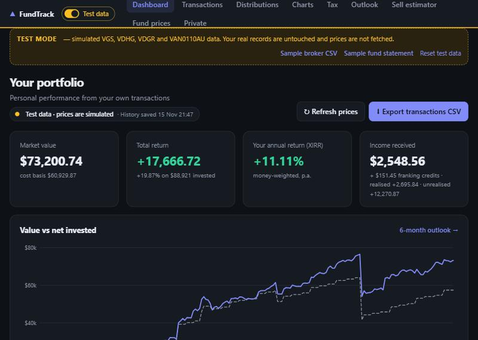

# Test Mode

A **Test data** switch in the page header flips the whole app onto a separate, persistent set of **simulated** investments built around **VGS, VDHG, VDGR and the unlisted VAN0110AU fund**. Use it to explore every page, try the importer, or demonstrate the app without entering anything real.



## How it's kept separate

- Test data is stored in its own file, `data/fundtrack-test.json`, next to your real data. Edits persist across restarts exactly like real data.
- Your real records are never opened for writing while the switch is on.
- The choice is remembered in `data/mode`.
- Price refresh is disabled in test mode: nothing is fetched. The web search for private-company valuations is also disabled.

```bash
TEST_MODE=1 go run .      # start in test mode   (TEST_MODE=0 forces real data)
```

## What's in it

About 130 transactions over roughly three years (deterministic apart from dates moving with "today"):

- Lump-sum and monthly/quarterly buys with brokerage; contract-note references on the first year (marked as a sample import so it can be undone).
- Quarterly distributions with franking credits, foreign-tax offsets, discountable capital gains and tax-deferred amounts; VDHG reinvested (DRP); June-quarter payments assigned to the earlier income year.
- Sells covering every CGT case: a discounted gain, a full-rate gain on a young parcel, and a capital loss.
- Five years of daily prices driven by shared market factors (so betas and correlations make sense), market benchmarks, weekly unit prices for the managed fund, and the latest distribution left unrecorded so the "may be missing" suggestions appear.
- A **target allocation** (VGS 30%, VDHG 30%, VDGR 25%, VAN0110AU 15%) that deliberately differs from the current mix, so a withdrawal has something to rebalance.

## The banner

- **Reset test data** regenerates it.
- **Sample broker CSV** and **Sample fund statement** are built from the test data so you can try the importer's duplicate handling (already recorded, possible duplicate, new, skipped).

## Trying other features

You can add owners, a private company, extra transactions and edits in test mode and they persist in the test file. That is how the screenshots in this wiki were made, using only invented data.
