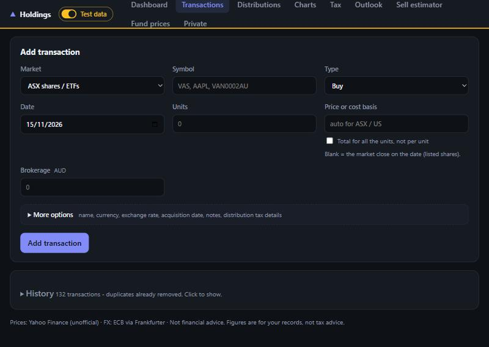

# Transactions

Everything in Holdings is derived from the transactions you record. Add them by hand here, or import them from a file ([Importing Transactions](Importing-Transactions.md)).

## Transaction types

| Type | Meaning | Effect |
|---|---|---|
| **Buy** | You paid to acquire units. | Adds a tax parcel and cost (price × units + brokerage). Counts as money invested. |
| **Sell** | You disposed of units. | Matched to parcels for capital gains ([Tax and CGT](Tax-and-CGT.md)). |
| **Distribution (cash)** | Income paid to you. | Income, with optional franking and tax detail. |
| **Distribution reinvested (DRP)** | Income used to buy more units. | Income **and** a new parcel at the reinvestment price. |
| **Shares awarded (RSU)** | Units received without paying cash, such as an RSU release. | Added at the market value on the vest date, which becomes the cost base. Treated as invested at that value for performance. |

## Adding a transaction

The main fields are always visible:

- **Market**: ASX shares/ETFs, US stocks/ETFs, Private company, Unlisted fund.
- **Symbol**: `VAS`, `AAPL`, an APIR code such as `VAN0002AU`, or a name for a private company.
- **Type** and **Date**.
- **Units**, **Price or cost basis** and **Brokerage** (AUD). The fields shown change with the type: a cash distribution only asks for the amount; a reinvestment asks for units, price and amount.

**More options** holds the less common fields: name, currency, FX rate, original acquisition date, "held over 12 months", notes and the distribution tax details. It opens by itself if you arrive with any of them filled in (for example from a suggested distribution).

### Prices are looked up for listed shares

For ASX and US buys, sells and awards, leave **Price** blank and Holdings uses the market close on the transaction date (the previous trading day for weekends and holidays, within a week). The note on the transaction records where the price came from. If no price can be found you get an error asking for one. Future dates are refused.

Unlisted funds and private companies have no market price, so you must enter a price or cost basis.

### Cost basis for older holdings

For holdings from before your price history, type your **own cost basis** in the price field. It is used exactly as typed and never overridden. If you only know the **total** cost, tick *Total for all the units, not per unit* and Holdings divides by the units. Brokerage is a separate field and isn't part of the total you type.

### Shares transferred from another broker

Under **More options**:

- **Original acquisition / vest date**: the transaction is recorded on this date, so the cost basis and the 12-month CGT clock follow the original acquisition. **Date** is then the transfer date, which is kept in the notes.
- **I don't know the acquisition date, but I held these over 12 months**: use only if you're sure. Those units are treated as long-term for the CGT discount (acquired a year and a day before the date). Ignored if you enter an acquisition date.

If you know neither, enter the transfer date and the cost basis; the discount then counts from the transfer date, which is the cautious choice.

### Distribution tax details

For distributions, **More options** has franked amount, franking credits, foreign tax, discountable and other capital gain components, tax-deferred (return of capital) amount and an optional tax year. Anything you don't break out is treated as unfranked income. Franked + capital gain + tax-deferred can't exceed the distribution. Details: [Tax and CGT](Tax-and-CGT.md).

## Distributions you may not have recorded

When Yahoo reports an ex-dividend date for units you held and there's no matching record, a card at the top lists it with an estimated amount. For ASX holdings the franking % and pay date are pulled from the ASX to pre-fill the credits. **Record** opens the form filled in.

## Editing a transaction

Each row in the history has a pencil icon. You can change the date, units, price or cost basis (with the *total* option), brokerage, FX rate, notes and the long-term flag. A common use is replacing a looked-up price with your real cost basis. The original fingerprint is kept, so re-importing the same broker row is still recognised as a duplicate and the old figures don't come back.

Delete removes a transaction after confirmation.

## History

The history table is collapsed at the bottom of the page to keep the top uncluttered. It shows each transaction with price in AUD (original currency in brackets), brokerage, the exchange rate used, AUD value and realised gain.

## Recent imports

Below the import box is a list of recent imports with how many rows were added, already recorded, held back and skipped. **Undo** removes everything a given import added.
